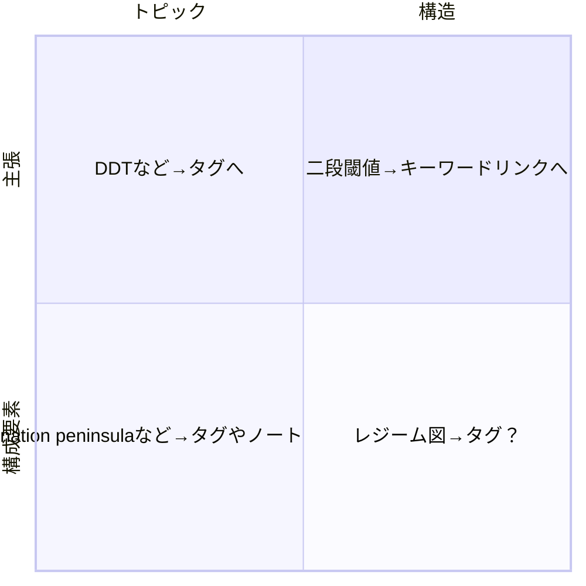

構造/トピック/形式の3要素による分類はどうだろうか。あまりよい感じはしない。構造とトピックの対比はハコとナカミの関係にあり他の分類が入る余地はない。そもそも形式語も構造化の一部ではある。

では以下のような四象限による分類はどうだろうか？Bradley's diagramの根本アイデアノートにおけるそれぞれの例も示す。

主張 x 構造の名詞はキーワードリンクに昇華できる可能性がある。逆に構造語であっても構成要素の構造語はキワードリンクにする価値が乏しそう。

---

[[直交性|独立した軸]]
